# DanaBus — Ứng dụng xe buýt thông minh

Ứng dụng di động **DanaBus** (Expo / React Native) cho hệ thống xe buýt thông minh:

- **Hành khách (`user`)**: tra cứu tuyến, tìm đường, mua vé QR, thanh toán, **theo dõi xe realtime + ETA**, **mức đông**, **nhắc khi xe sắp tới**, gợi ý đánh giá sau chuyến, gói du lịch.
- **Nhân viên (`staff`)**: nhận ca, **gửi GPS**, chuyển trạm, quét vé QR, báo cáo ca, nghỉ phép.
- **Quản trị (`admin`)**: API backend (không có UI trong app mobile này).

Hỗ trợ đa ngôn ngữ: **Tiếng Việt**, **English**, **日本語**.

> Roadmap / đề xuất khác biệt: [`docs/differentiation-proposal.md`](docs/differentiation-proposal.md) (Trục A đã ship MVP).

<p align="center">
  
</p>

---

## Mục lục

- [Phân quyền (3 role)](#phân-quyền-3-role)
- [Tính năng theo role](#tính-năng-theo-role)
- [Live transit — Trục A (mới)](#live-transit--trục-a-mới)
- [Ma trận tóm tắt](#ma-trận-tóm-tắt-proposal)
- [Ảnh giao diện ứng dụng](#ảnh-giao-diện-ứng-dụng)
- [Công nghệ](#công-nghệ)
- [Cài đặt & chạy](#cài-đặt--chạy)
- [Cấu trúc thư mục](#cấu-trúc-thư-mục)
- [Liên hệ / ghi chú](#liên-hệ--ghi-chú)

---

## Phân quyền (3 role)

| Role | Đối tượng | Client trong repo này |
|------|-----------|------------------------|
| `user` | Hành khách | **Mobile app** — tab Home / Thông báo / Thanh toán / Tài khoản |
| `staff` | Nhân viên soát vé / vận hành ca | **Mobile app** — stack `/staff` (không dùng bottom tabs hành khách) |
| `admin` | Quản trị hệ thống | **Không có UI mobile** — dùng API backend (console web ngoài phạm vi app) |

Sau đăng nhập, app điều hướng theo role (`staff` → `/staff`, còn lại → tabs hành khách). Tài khoản `staff` / `admin` do backend cấp — đăng ký app luôn tạo role `user`.

---

## Tính năng theo role

### 1. Hành khách (`user`)

| Nhóm | Chức năng chi tiết |
|------|---------------------|
| **Tài khoản & xác thực** | Đăng ký (OTP email) → xác thực OTP → tạo tài khoản; đăng nhập JWT; quên mật khẩu (OTP) → đặt lại mật khẩu; cập nhật hồ sơ (họ tên, SĐT, giới tính, ngày sinh, nghề nghiệp, địa chỉ); validate form (Zod); đăng xuất |
| **Trang chủ** | Tìm điểm đi–đến + autocomplete; lối tắt: tra cứu tuyến, trạm gần, yêu thích, đánh giá; carousel tuyến nổi bật; mẹo đi lại; tin tức; FAQ preview; **gợi ý đánh giá sau chuyến** (`ReviewPromptCard`); **gói du lịch** (`TourPackPreview`) |
| **Tìm chuyến / lộ trình** | Tìm A→B (đi bộ + xe buýt, có thể nhiều chặng); danh sách kết quả; chi tiết hành trình + bản đồ; mua vé từ kết quả |
| **Mua vé điện tử** | Vé **lượt** / **tháng đơn tuyến** / **tháng liên tuyến**; form (giờ, ghế/số lượng, tháng, điều khoản); chọn phương thức thanh toán; xác nhận → tạo vé + **mã QR** lên xe |
| **Vé của tôi** | Danh sách vé; trạng thái (còn hiệu lực / đã dùng / hết hạn…); chi tiết; xem QR |
| **Lịch sử chuyến** | Vé đã sử dụng / hết hạn (trip history) |
| **Tuyến & trạm** | Tra cứu / tìm tuyến; **chi tiết tuyến** gồm tab: **Xe đang chạy** · Giờ chạy · Trạm · Thông tin · Đánh giá; bản đồ trạm + **marker xe realtime**; tìm **trạm xung quanh** (GPS) |
| **Live / ETA / đông** | Xem xe đang chạy trên tuyến (GPS staff hoặc GPS cố định trên xe); ETA tới trạm đã chọn; badge mức đông (`Còn chỗ` / `Vừa` / `Đông` / `Rất đông`) |
| **Theo dõi trạm + push** | Chọn trạm trên tab live → đăng ký `TripSubscription`; app đăng ký Expo push token (dev/production build); backend worker nhắc khi ETA ≤ ngưỡng (~5 phút) |
| **Yêu thích** | Thêm / bỏ / xem danh sách tuyến yêu thích |
| **Đánh giá tuyến** | Xem danh sách & rating; viết đánh giá (sao + nội dung); xóa đánh giá của mình; prompt Home khi đã đi nhưng chưa review |
| **Du lịch (A5)** | Card Home “Dành cho khách du lịch”; gói POI / hướng dẫn mua vé theo locale `vi` · `en` · `ja` (API `/api/tour-packs`) |
| **Thanh toán** | Quản lý phương thức đã lưu; thêm / cập nhật tài khoản–thẻ ngân hàng; xem chi tiêu vé gần đây |
| **Thông báo / tin tức** | Feed tin tức & thông báo dịch vụ; sắp xếp mới / cũ; chi tiết bài viết |
| **Hồ sơ & cài đặt** | Thẻ người dùng; menu tài khoản / dịch vụ / cài đặt; đổi ngôn ngữ; Trung tâm trợ giúp (FAQ); Điều khoản; Chính sách bảo mật; Về DanaBus |
| **Đa ngôn ngữ (i18n)** | `vi` · `en` · `ja` — **Tài khoản → Ngôn ngữ** (`src/i18n/locales/`) |

> **Ghi chú hành khách:** Quét QR lên xe do **nhân viên** thực hiện trong ca (tab “Quét QR” hành khách là stub). Báo cáo sự cố tuyến có API backend nhưng **chưa có màn hình** trong app. **Remote push không chạy trên Expo Go** (SDK 53+) — cần development build / production build.

---

### 2. Nhân viên (`staff`)

Tài khoản staff do admin cấp (không tự đăng ký trên app). Sau login vào hub `/staff`.

| Nhóm | Chức năng chi tiết |
|------|---------------------|
| **Đăng nhập** | Đăng nhập JWT; tự chuyển giao diện nhân viên |
| **Dashboard** | Banner **Nhận ca / tiếp tục ca**; tuyến được giao; lịch ca tuần (ngày / sáng–chiều–tối); lối tắt (quét vé, nghỉ phép, lịch sử, thông báo) |
| **Ca đang chạy (Active shift)** | Check-in nhận ca (gắn lịch / tuyến / biển số); **gửi GPS định kỳ ~20s** (`useStaffShiftLocation`); bản đồ tuyến; **chuyển điểm dừng** (sync `advance-stop`); **quét QR vé** (camera hoặc nhập mã) gắn `shiftId` + `stopId`; lịch sử quét trong ca; kết thúc ca |
| **Báo cáo ca** | Preview thống kê (lượt quét, doanh thu…); gửi báo cáo; xem trạng thái (chờ duyệt / đã duyệt / từ chối) |
| **Nghỉ phép** | Gửi đơn (từ–đến ngày + lý do); xem danh sách & trạng thái |
| **Hoạt động** | Lịch sử gộp: tab **báo cáo ca** + tab **đơn nghỉ** |
| **Thông báo nội bộ** | Màn thông báo nhân viên (hiện dữ liệu mẫu trên client) |

> **Ghi chú nhân viên:** Duyệt nghỉ / duyệt báo cáo ca thuộc **admin** (API). Nguồn vị trí live cho hành khách phụ thuộc staff **mở app + cho GPS khi ca active** (A1-Lite). Có thể bổ sung GPS cố định trên xe qua API backend (A1-Full).

---

### 3. Quản trị (`admin`) — ngoài phạm vi UI mobile

App **không** có màn hình admin. Năng lực do **Backend API** cung cấp:

| Nhóm | Chức năng (API) |
|------|-----------------|
| **Người dùng** | Danh sách / chi tiết; bật–tắt `active`; xóa (không xóa admin / chính mình) |
| **Dashboard** | KPI: user, vé, tuyến, báo cáo, doanh thu, time-series, top tuyến… |
| **Loại vé** | CRUD / ngưng bán (`single`, `monthlySingleRoute`, `monthlyInterRoute`) |
| **Lịch ca** | Tạo lịch ca staff (ngày, khung giờ, tuyến, biển số…) |
| **Duyệt báo cáo ca** | Danh sách + approve / reject |
| **Tuyến & trạm** | CRUD tuyến; gán `staffId`; CRUD điểm dừng |
| **Tin tức** | CRUD bài viết (feed trên app) |
| **Báo cáo sự cố** | Xem route report từ hành khách |
| **Live / notify (ops)** | Worker push (`WORKER_SECRET`); ingest GPS xe (`VEHICLE_GPS_SECRET`) — xem backend `.env.example` |

---

## Live transit — Trục A (mới)

Chi tiết thiết kế: [`docs/differentiation-proposal.md`](docs/differentiation-proposal.md).

| Mã | Chức năng | User app | Staff app | Backend |
|----|-----------|:--------:|:---------:|:-------:|
| **A1-Lite** | Xe realtime + ETA từ GPS điện thoại NV | Tab **Xe đang chạy**, marker map, ETA | Gửi location ~20s, advance-stop | `/api/live/*`, `/api/staff-shifts/location` |
| **A1-Full** | GPS cố định trên xe | Cùng UI (nguồn `(xe)`) | — | `POST /api/live/vehicle-gps` |
| **A2** | Nhắc khi xe sắp tới trạm | Theo dõi trạm + đăng ký push token | — | `/api/notify/*` + `npm run worker:push` |
| **A3** | Mức đông ước lượng | Badge trên card xe | Scan hợp lệ trong ca | `/api/live/crowding` (scan / capacity) |
| **A4** | Gợi ý đánh giá sau khi đi | `ReviewPromptCard` trên Home | Scan → ticket used | `unreviewedOnly` trên list routes |
| **A5** | Gói du lịch đa ngữ | `TourPackPreview` trên Home | — | `/api/tour-packs` (pack tĩnh) |

### Cách demo nhanh (2 tài khoản)

1. **Staff:** login → `/staff` → **Nhận ca** → cho phép GPS → giữ màn Active Shift.
2. **User:** login → mở **cùng tuyến** → tab **Xe đang chạy** → thấy marker vàng + ETA.
3. User chọn chip **Theo dõi trạm** (lưu subscription).
4. (Tuỳ chọn) Backend: `npm run worker:push` khi ETA đủ gần — push thật cần **dev build**, không dùng Expo Go.

---

## Ma trận tóm tắt (proposal)

| Năng lực | User (app) | Staff (app) | Admin (API) |
|----------|:----------:|:-----------:|:-----------:|
| Đăng ký / OTP / quên MK | ✅ | — | — |
| Đăng nhập | ✅ | ✅ | ✅ |
| Tìm lộ trình A→B + bản đồ | ✅ | — | — |
| Mua vé + nhận QR | ✅ | — | — |
| Vé của tôi / lịch sử chuyến | ✅ | — | — |
| Tuyến, trạm gần, yêu thích | ✅ | Xem tuyến được giao | CRUD tuyến/trạm |
| **Live xe + ETA + marker** | ✅ | Gửi GPS / advance-stop | Ingest GPS xe |
| **Theo dõi trạm + push ETA** | ✅* | — | Worker dispatch |
| **Mức đông (crowding)** | ✅ | Scan trong ca | Capacity xe |
| **Prompt đánh giá sau chuyến** | ✅ | — | — |
| **Gói du lịch (tour packs)** | ✅ | — | Content API |
| Đánh giá tuyến | ✅ | — | — |
| Phương thức thanh toán | ✅ | — | — |
| Tin tức / thông báo | ✅ | Màn thông báo (mock) | CRUD bài viết |
| Check-in / ca / quét QR | — | ✅ | — |
| Báo cáo ca (gửi / xem) | — | ✅ | Duyệt |
| Xin nghỉ (gửi / xem) | — | ✅ | *(duyệt: backlog)* |
| Quản lý user / KPI / loại vé / lịch ca | — | — | ✅ |
| i18n vi · en · ja | ✅ | ✅ | — |

\*Push remote: development / production build (không hỗ trợ trên Expo Go SDK 53+).

---

## Ảnh giao diện ứng dụng

> Mở preview README (`Ctrl+Shift+V`) để xem ảnh inline. Nguồn: thư mục [`public/`](public/).

### Trang chủ & điều hướng

| Trang chủ — tìm đường | Trang chủ — tin tức & FAQ | Thông báo |
|:---:|:---:|:---:|
| 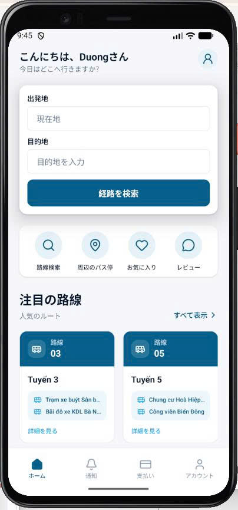 | 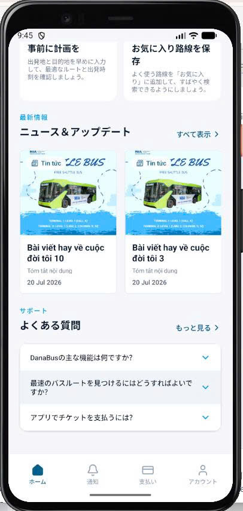 | 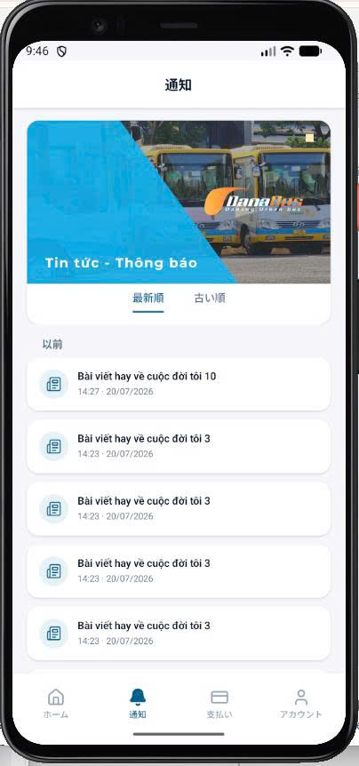 |
| Tìm điểm đi–đến, lối tắt, tuyến nổi bật | Mẹo đi lại, tin tức, FAQ | Tin tức–thông báo, sắp xếp mới/cũ |

| Thanh toán | Tài khoản |
|:---:|:---:|
| 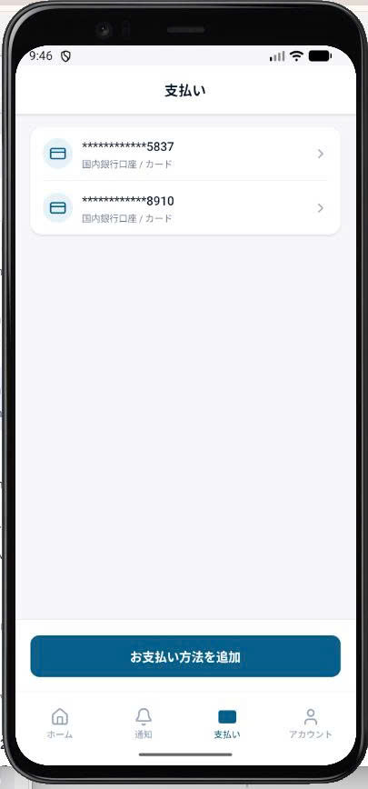 | 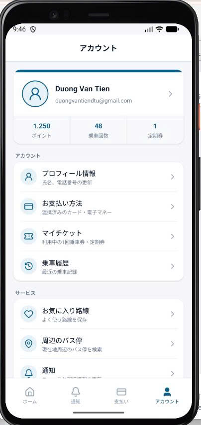 |
| Phương thức đã lưu, thêm ngân hàng/thẻ | Hồ sơ, điểm, vé, lịch sử, dịch vụ |

### Tìm lộ trình & mua vé

| Chọn loại vé | Kết quả lộ trình | Chi tiết lộ trình |
|:---:|:---:|:---:|
| 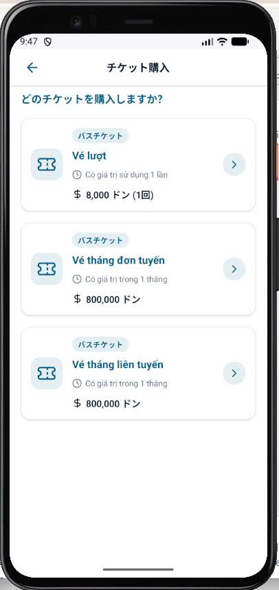 | 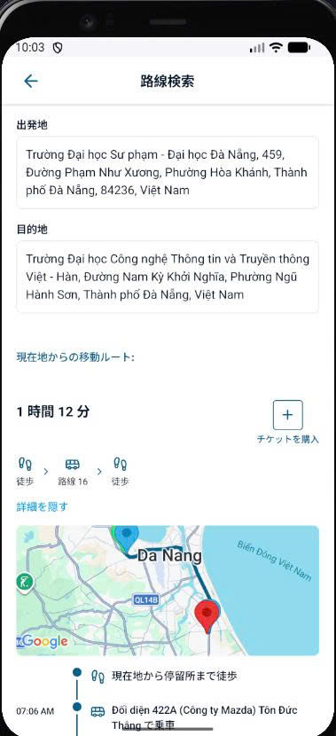 | 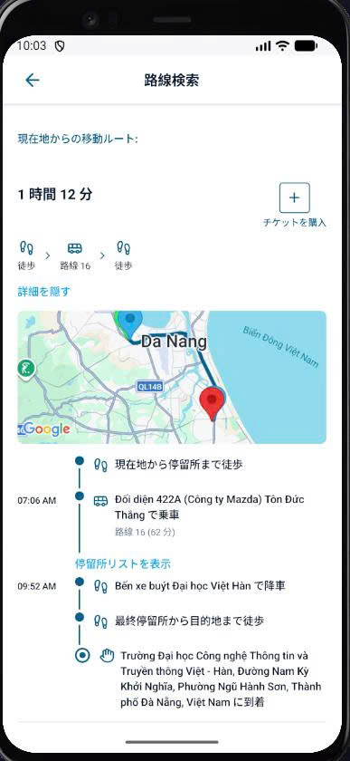 |
| Vé lượt / tháng đơn / liên tuyến | Bản đồ, thời gian, mua vé | Timeline từng chặng |

| Chọn vé (luồng mua) | Form vé tháng | Thanh toán vé |
|:---:|:---:|:---:|
|  | 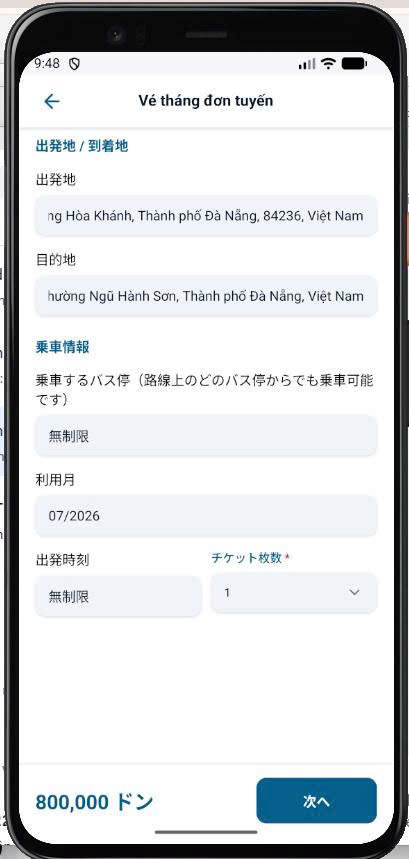 | 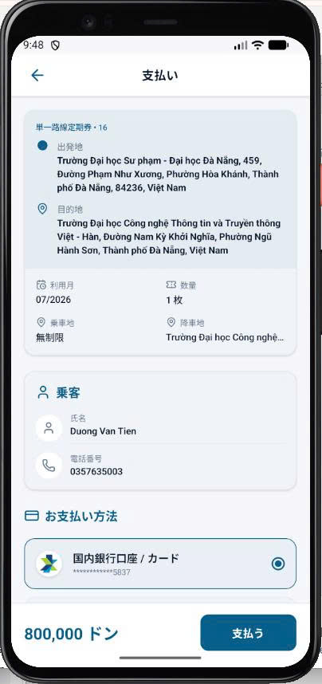 |
| Chọn loại trước khi điền form | Điểm đi–đến, tháng, số lượng | Xác nhận & thanh toán |

| QR vé thành công | Vé của tôi |
|:---:|:---:|
|  | 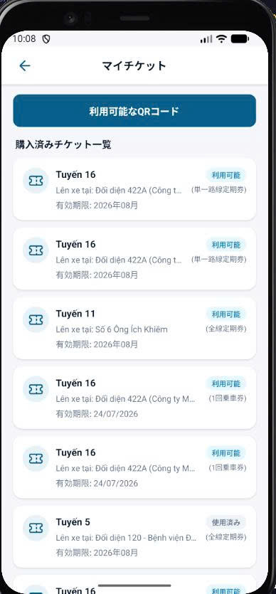 |
| Mã QR lên xe, mã vé | Danh sách vé, trạng thái, mở QR |

### Tuyến, bản đồ & đánh giá

| Bản đồ tìm trạm | Tuyến yêu thích | Danh sách đánh giá |
|:---:|:---:|:---:|
| 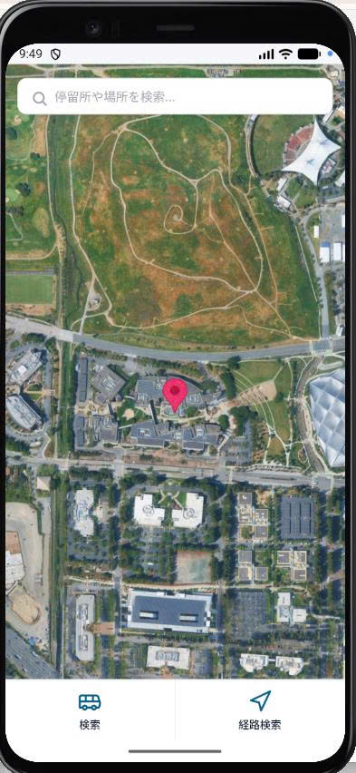 | 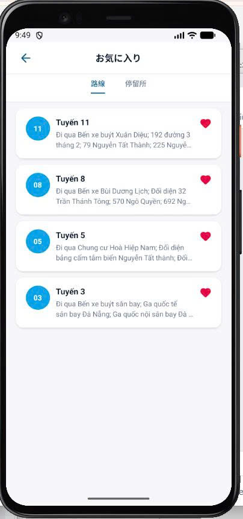 | 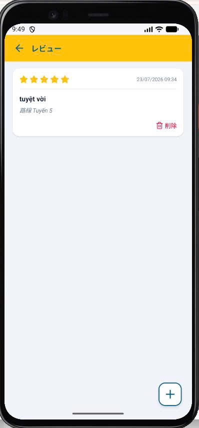 |
| Tìm trạm / địa điểm | Tuyến & trạm đã lưu | Xem / xóa đánh giá |

| Viết đánh giá | Chi tiết tuyến — giờ chạy | Chi tiết tuyến — trạm |
|:---:|:---:|:---:|
| 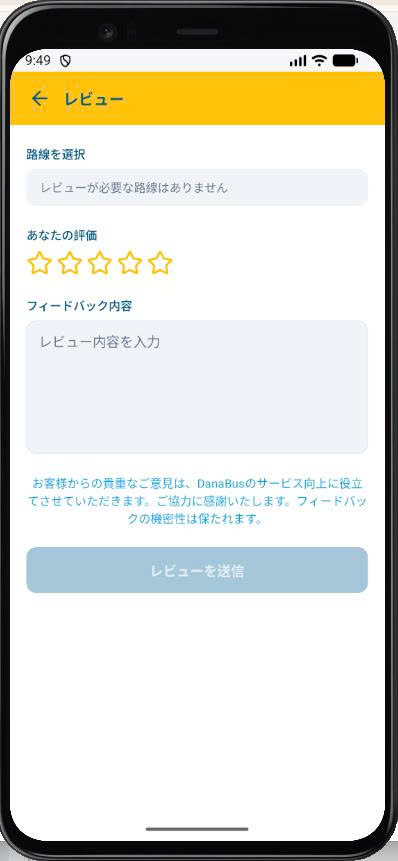 | 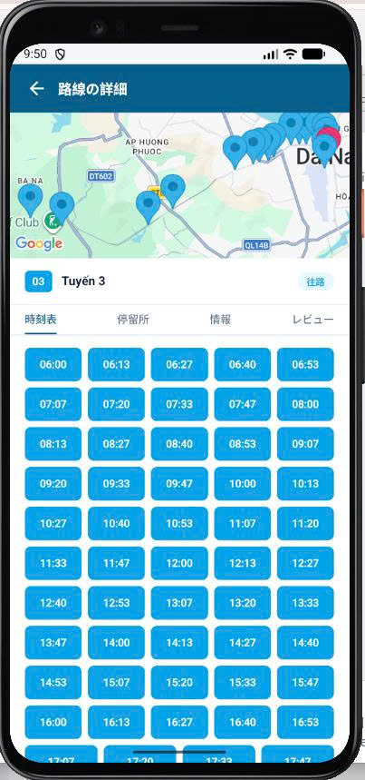 | 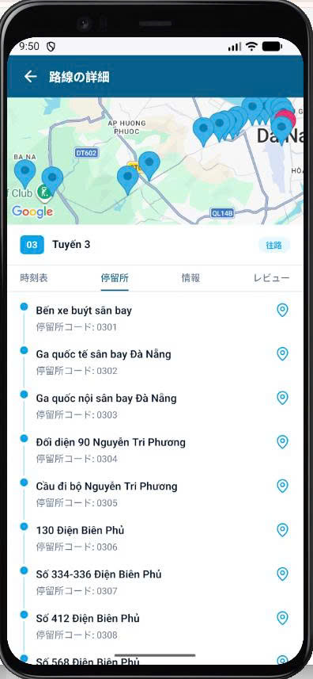 |
| Chấm sao, gửi feedback | Lưới giờ xuất phát | Danh sách trạm + mã |

| Chi tiết tuyến — thông tin | Chi tiết tuyến — đánh giá |
|:---:|:---:|
| 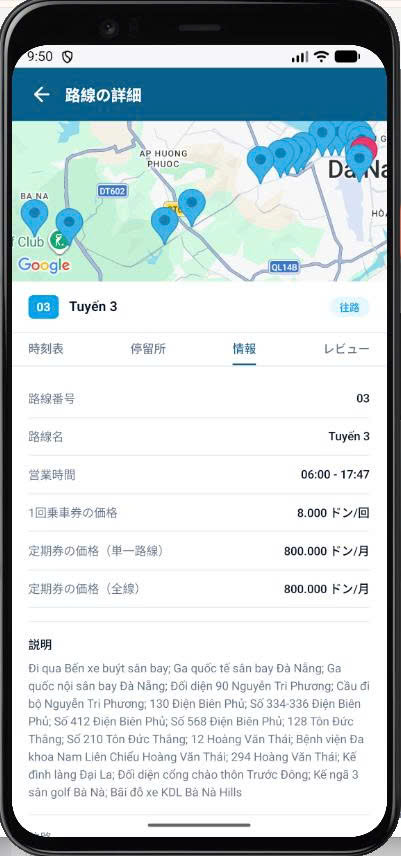 | 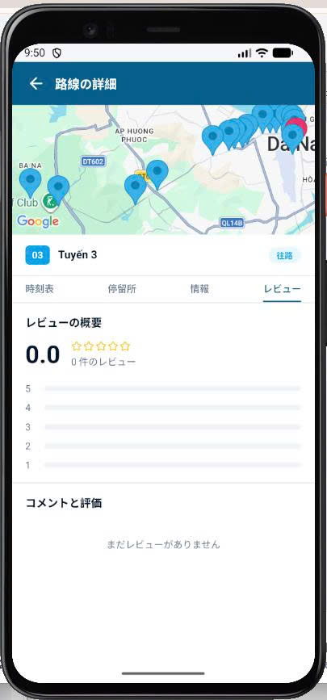 |
| Giá vé, giờ hoạt động, mô tả | Tổng quan điểm & bình luận |

> Ảnh demo chưa cập nhật tab **Xe đang chạy** / marker live — dùng app mới nhất để xem UI realtime.

<details>
<summary><strong>Xem từng ảnh full size (click để mở rộng)</strong></summary>

<br/>

**1. Trang chủ — tìm đường**


**2. Trang chủ — tin tức & FAQ**


**3. Thông báo**


**4. Thanh toán**


**5. Tài khoản**


**6. Chọn loại vé**


**7. Kết quả lộ trình**


**8. Chi tiết lộ trình**


**9. Chọn vé (luồng mua)**


**10. Form vé tháng**


**11. Thanh toán vé**


**12. QR vé thành công**


**13. Bản đồ tìm trạm**


**14. Tuyến yêu thích**


**15. Danh sách đánh giá**


**16. Viết đánh giá**


**17. Chi tiết tuyến — giờ chạy**


**18. Chi tiết tuyến — trạm**


**19. Chi tiết tuyến — thông tin**


**20. Chi tiết tuyến — đánh giá**


**21. Vé của tôi**


</details>

---

## Công nghệ

- **Expo** ~54 · **expo-router** (file-based routing)
- **React Native** + **NativeWind** (Tailwind)
- **TypeScript**
- **Zustand** (auth, locale, trip booking, staff shift)
- **Zod** (validate form: auth, ngân hàng, hồ sơ…)
- **Axios** · AsyncStorage
- **expo-location** · **expo-camera** · **expo-notifications** · **react-native-maps**
- **i18n** tự xây: `vi` / `en` / `ja`
- Backend kèm theo: live ETA, crowding, notify/push worker, tour packs, vehicle GPS ingest

---

## Cài đặt & chạy

### Yêu cầu

- Node.js 18+
- npm (hoặc yarn / pnpm)
- Expo Go hoặc Android Emulator / iOS Simulator
- Backend `Backend-SmartBus` đang chạy (mặc định port `3000`)

### Cài đặt

```bash
cd Mobile-SmartBus
npm install
```

### API base URL

Chỉnh trong `src/services/axiosIntance.ts`:

| Môi trường | Gợi ý |
|------------|--------|
| Android Emulator | `http://10.0.2.2:3000/api` |
| iOS Simulator | `http://localhost:3000/api` |
| Máy thật / Expo Go (LAN) | `http://<IP-máy-dev>:3000/api` |

### Chạy app

```bash
npx expo start
```

Sau đó mở bằng:

- [Expo Go](https://expo.dev/go) — đủ để test live map / ETA / theo dõi trạm (không có remote push)
- Android emulator: `a`
- iOS simulator: `i`
- Web: `w` (một số tính năng map/camera hạn chế)

Hoặc:

```bash
npm run android
npm run ios
npm run web
```

### Lint

```bash
npm run lint
```

### Backend liên quan (live / push)

```bash
cd ../Backend-SmartBus
npm run dev
# Gửi push ETA (cron / thủ công):
npm run worker:push
```

Biến môi trường backend: `WORKER_SECRET`, `VEHICLE_GPS_SECRET` (xem `.env.example`).

---

## Cấu trúc thư mục

```
Mobile-SmartBus/
├── public/                      # Ảnh chụp màn hình (README)
├── assets/images/               # Logo, icon, banner
├── docs/
│   └── differentiation-proposal.md   # Roadmap Trục A–E
├── src/
│   ├── app/                     # Routes (expo-router)
│   │   ├── (auth)/              # Login, register, OTP, quên MK
│   │   ├── (tabs)/              # Home, thông báo, thanh toán, hồ sơ
│   │   ├── (pages)/             # Tuyến, chuyến, vé, profile…
│   │   └── staff/               # Luồng nhân viên
│   ├── screen/
│   │   ├── Home/                # + ReviewPromptCard, TourPackPreview
│   │   ├── Route/Detail/        # + LiveTab, RouteDetailMap (marker xe)
│   │   └── Staff/ActiveShift/   # GPS + quét QR + advance-stop
│   ├── hooks/
│   │   ├── useStaffShiftLocation/
│   │   └── usePushNotifications/   # no-op trên Expo Go
│   ├── components/
│   ├── i18n/                    # vi / en / ja
│   ├── services/                # LiveService, NotifyService, TourPackService…
│   ├── store/                   # auth, locale, staffShift…
│   └── utils/                   # validators, formatCurrency…
├── app.json
├── package.json
└── README.md
```

---

## Liên hệ / ghi chú

- Brand trong sản phẩm: **DanaBus**
- Repo package: `app-native-smartbus` · thư mục: `Mobile-SmartBus`
- Backend API: repo `Backend-SmartBus` (role `user` / `staff` / `admin`)
- Đề xuất chức năng khác biệt: [`docs/differentiation-proposal.md`](docs/differentiation-proposal.md)
- Ảnh demo README: [`public/`](./public/) (`image_1.jpg` … `image_21.jpg`) — chưa gồm screenshot tab live
- Admin Web Console **chưa** nằm trong repo mobile — chỉ có API backend
- Trục B–E (admin web, ví, offline scan…) **chưa** triển khai trong app này
